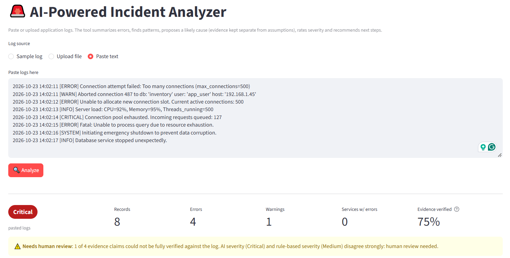
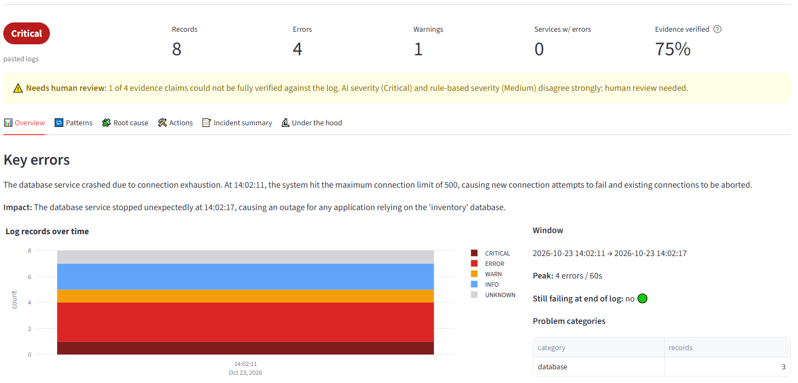
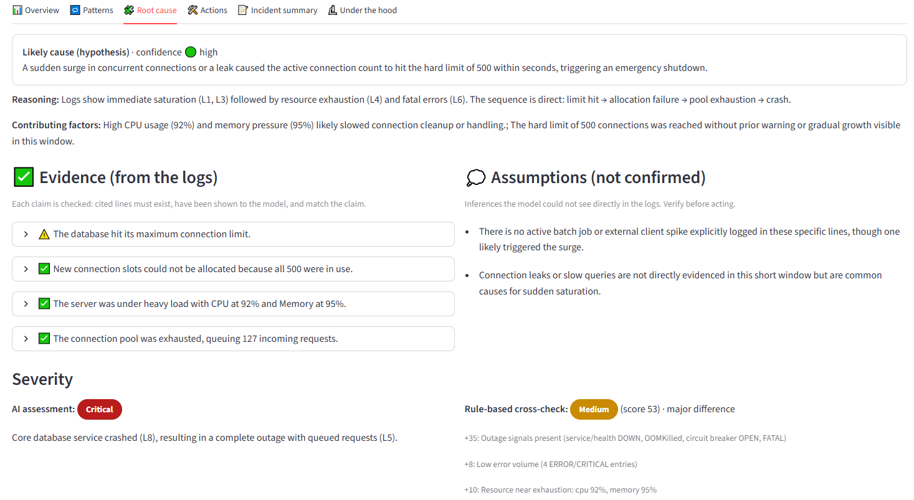
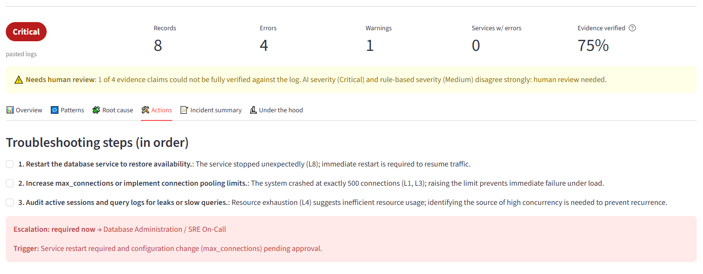

# AI-Powered Incident Analyzer

Paste or upload application logs. The tool summarizes errors and patterns and proposes a likely cause, keeping cited
evidence separate from assumptions. It assigns a severity with reasons, recommends next steps and when to escalate,
and writes a shareable incident summary.

It runs **fully locally**: the model is served by [Ollama](https://ollama.com) (`qwen3.5:9b`), so no log data leaves the machine.

## Screenshots

A database connection-exhaustion log pasted into the app. The run also shows the safety checks at work: one evidence
claim is only partly supported, and the AI and rule severities disagree, so the result is flagged for human review.

| Paste logs and analyze | Overview: severity, key errors, timeline |
|---|---|
|  |  |
| **Root cause: evidence vs. assumptions, two severity opinions** | **Actions: ordered steps and escalation** |
|  |  |

## Quick start

Requirements: Python 3.10+ and a running Ollama with the model pulled.

```powershell
ollama pull qwen3.5:9b
python -m venv .venv
.\.venv\Scripts\activate            # macOS/Linux: source .venv/bin/activate
pip install -r requirements.txt

streamlit run app.py                # web UI -> http://localhost:8501
python cli.py sample_logs\payment_db_timeout.log   # CLI (add --no-llm for instant rule-only analysis)
python -m pytest -q tests           # 39 unit tests, no Ollama needed
```

Settings such as the Ollama URL, model and context size go in `.env` (see `.env.example`) or the UI sidebar.

## Approach: parse first, reason second, verify last

```
logs ─► Parser ─► Pattern analyzer ─► Rule severity ──────────────┐ (independent cross-check)
              └─ facts digest + numbered log lines ─► LLM (JSON schema) ─► Validator ─► UI / report
```

The work is split between code and the model. A local model is good at reasoning about an incident but unreliable at
counting and prone to inventing details, so code handles the facts and the model reasons over them.

| Requirement | How it is met |
|---|---|
| Summarize errors and patterns | The parser handles plain, ISO, bracketed, syslog and JSON-lines logs, and attaches stack traces to their record. Messages are normalized into **signatures** (IDs and numbers masked) and grouped with counts, first/last seen, bursts and resource peaks. |
| Likely cause, evidence vs. assumptions | The output schema has separate `evidence[]` (with cited line numbers) and `assumptions[]`. Evidence is ordered before the cause, so the model commits to observations first. |
| Severity with reasoning | Two independent opinions: a transparent **rule score**, where every point has a stated reason, and the **AI's assessment**. If they are two or more levels apart, the result is flagged for human review. |
| Troubleshooting and escalation | Ordered next steps plus an escalation decision with who to involve and why. |
| Incident summary | A ready-to-share summary, downloadable as Markdown or JSON. |

**Hallucination controls.** The validator checks that every cited line exists, was shown to the model, and matches
the claim, and marks each claim as verified, weak or unverified. It flags numbers that appear nowhere in the log and
downgrades confidence when evidence is weak. If Ollama is down, the app still shows the full rule-based analysis.

## Models and tools

* **Runtime:** Ollama with `qwen3.5:9b` (6.6 GB), using structured JSON output at temperature 0 with a fixed seed.
  No cloud APIs are called.
* **Development:** I built this with an AI coding assistant (Claude Code). My role was to turn the brief into
  requirements and set the design constraints: local-only inference, a model under 10 GB, and evidence kept separate
  from assumptions. I directed the implementation, chose and switched models based on quality and speed on my
  hardware, ran and reviewed the app and tests on the sample incidents, and prepared the submission.

## Testing

* **Unit tests** (39): parser formats, pattern grouping, severity per sample, validator (fake citations, invented
  numbers, severity disagreement), and the pipeline with a fake LLM (retry on invalid JSON, Ollama-down fallback,
  large logs).
* **Scenario evaluation** (`python tests\eval_scenarios.py`): runs six simulated incidents (Critical to Low) through
  the real model. It scores JSON validity, severity, required root-cause concepts and evidence grounding.
* **Results so far:** on the payment outage sample, `qwen3.5:9b` rated it **Critical** (as expected), identified
  the batch job exhausting the DB pool as the trigger, and 3 of 4 evidence claims were verified. A partial run with
  the earlier `qwen2.5:7b` gave acceptable severity and found every required cause concept on both samples it
  covered.

## Assumptions and limitations

* Logs are mostly English text with timestamps and levels. Unknown formats are still kept, with a warning shown.
* The cause is a **hypothesis from logs alone**, with no metrics, traces or deploy history. The validator catches
  invented references but cannot prove the reasoning is right.
* Speed depends on hardware: about 8 minutes per analysis on a 4 GB GPU laptop, and seconds on a GPU that fits the model.
* Possible next steps: search over runbooks and past incidents, Jira/Slack export, and correlating several log files.

## Project structure

```
app.py, cli.py       Streamlit UI and command line
analyzer/            parser, patterns, severity, prompts, schema, llm_client, validator, pipeline, report
sample_logs/         six simulated incidents
tests/               unit tests and scenario evaluation
```
